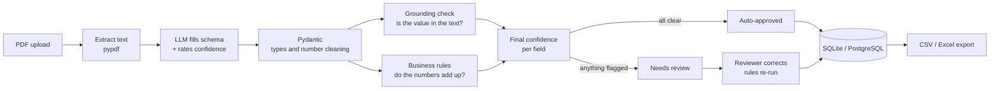

# AI Document Extractor

Upload an invoice, purchase order or receipt as a PDF and get clean, structured data back. Every field gets a confidence score, and anything uncertain is flagged for a person to check before it reaches your accounting system.

Most document-AI demos stop at "the model returned some JSON". This project focuses on what makes extraction usable in a real business: **knowing when the model is wrong.**

- **Grounding check:** every extracted value is looked up in the document text. A value that isn't there, which is a hallucination, gets flagged even if the model was confident.
- **Business rules:** line items must add up to the subtotal, the subtotal plus tax must equal the total, quantity × unit price must equal the amount, and the due date can't be before the invoice date.
- **Human review:** flagged fields are highlighted in the web app. A reviewer corrects them, the rules run again, and the document is marked reviewed.
- **Measured accuracy:** an evaluation script scores the system on 25 invoices with known answers and reports how many of the model's errors were caught.

Export to **CSV** (one row per line item, the shape accounting tools import) or **Excel**.

---

## How it works



### How confidence is scored

The model rates its own confidence for each field, but models are often confidently wrong, so that number is only a starting point:

| Situation | Effect on confidence | Flag |
|---|---|---|
| Value not found in the document | capped at 0.4 | `not found in document` |
| Value breaks a business rule | capped at 0.3 | `fails a validation check` |
| Required field missing | set to 0 | `required but missing` |
| Model's own confidence below the threshold (0.7) | unchanged | `low model confidence` |

A document is **auto-approved** only if no field is flagged and no rule fails. Otherwise it goes to **needs review**.

---

## Evaluation

`eval/` contains 25 synthetic invoices in three layouts (UK, US and EU), with different date formats (23/05/2026, February 27, 2026, 2026-09-16), currencies and number formats (£1,515.94 and €1.792,57), plus quirks such as missing due dates, zero tax and two-line addresses. Each one has a JSON answer key.

```bash
python eval/run_eval.py            # writes eval/results.md
```

It reports:
- **Field accuracy:** the share of fields that are exactly right.
- **Error catch rate:** of the fields the model got wrong, how many were flagged. This is the number that matters in production, because a flagged error gets fixed and an unflagged one slips through.
- **False alarm rate:** correct fields flagged anyway, which means unnecessary review work.
- **Auto-approved documents that still had an error:** this should be zero.

With a model that returns the correct answers, the checks raise no false alarms on any of the 25 documents, so the grounding and rule checks don't flag correct values. Run the script with your own model to get real accuracy figures. Results depend on the model you use.

---

## Quick start

```bash
git clone https://github.com/<your-username>/ai-document-extractor.git
cd ai-document-extractor
python -m venv .venv
source .venv/bin/activate          # Windows: .venv\Scripts\activate
pip install -r requirements-dev.txt
cp .env.example .env               # Windows: copy .env.example .env
```

Choose a model in `.env`:
- **Free and local:** install [Ollama](https://ollama.com) and run `ollama pull llama3.1`. This is the default.
- **OpenAI:** set `LLM_BASE_URL=https://api.openai.com/v1`, `LLM_API_KEY=sk-...` and `LLM_MODEL=gpt-4o-mini`.

Run:
```bash
uvicorn app.main:app --reload
```
Then open http://localhost:8000 and upload one of the PDFs in `eval/samples/`. The API docs are at http://localhost:8000/docs.

### API

| Method | Path | Purpose |
|---|---|---|
| `POST` | `/api/extract` | Upload a PDF (`file`) with a `doc_type` of `invoice`, `purchase_order` or `receipt` |
| `GET` | `/api/extractions` | List recent extractions (`?status=needs_review`) |
| `GET` | `/api/extractions/{id}` | One extraction, with per-field confidence, flags and issues |
| `PATCH` | `/api/extractions/{id}` | Save reviewer corrections (`{"data": {...}}`); the rules run again |
| `GET` | `/api/extractions/{id}/export?format=csv\|xlsx` | Export one document |
| `GET` | `/api/export?format=csv\|xlsx` | Export everything |

```bash
curl -F "file=@eval/samples/invoice_01.pdf" -F "doc_type=invoice" localhost:8000/api/extract
```

---

## Deploy a public demo

The repo includes a `Dockerfile` and a `render.yaml` for [Render](https://render.com):

1. In Render, choose **New → Blueprint** and select this repository.
2. Enter the values that aren't committed to the repo:
   - `LLM_API_KEY`: an OpenAI key. A hosted server can't reach Ollama on your laptop.
   - `DEMO_ACCESS_CODE`: only people you give the code to can upload.
   - `DATABASE_URL`: a free PostgreSQL database, for example from Neon or Supabase. Without it the app uses SQLite, which is wiped whenever a free server restarts.
3. Deploy.

**Cost controls:** uploads are limited to 5 MB and 5 pages, each visitor can make 20 extractions an hour, and you can set an access code. Free-tier hosting plans change often, so check current limits before relying on one.

**Privacy:** uploaded PDFs are processed in memory and never stored. Only the extracted data is saved.

---

## Tests

```bash
pytest -v
```

The tests run offline with a fake model. They cover number cleaning (including European formats), grounding, every business rule, confidence capping (a confident hallucination is still flagged), partial recovery when one field is malformed, reviewer corrections, SQLite and PostgreSQL storage, CSV and Excel export, rate limiting, the access code, upload limits, error handling and the evaluation script. GitHub Actions runs them against a real PostgreSQL database on every push.

## Project structure

```
app/
  main.py          FastAPI app: web page + JSON API, access code, rate limit
  extractor.py     pipeline and confidence scoring
  schemas.py       fields for each document type, number cleaning
  grounding.py     "is this value really in the document?"
  validation.py    business rules
  pdf_text.py      PDF to text; detects scanned and encrypted files
  llm.py           OpenAI-compatible client, JSON parsing and retry
  storage.py       SQLite / PostgreSQL
  export.py        CSV and Excel
  ratelimit.py     per-visitor hourly limit
  static/          the single-page web app (plain HTML and JavaScript)
eval/
  generate_samples.py   builds the synthetic invoices and answer keys
  run_eval.py           accuracy, error catch rate and false alarm rate
  samples/              25 PDFs and their answer keys
```

## Limitations and next steps

- **Scanned PDFs aren't supported yet.** They're detected and rejected with a clear message. Next step: OCR, or a vision model.
- **The evaluation uses synthetic invoices.** Real invoices are messier, so a set of real, anonymised documents would make the figures more meaningful.
- **Grounding checks values, not meaning.** A real number taken from the wrong place, such as the subtotal reported as the total, passes grounding. The business rules usually catch it, but not always.
- **The rate limiter is in memory,** which is fine for one server. Several servers would need Redis.
- **Ideas:** email-inbox ingestion, a webhook to push approved documents into accounting software such as Xero or QuickBooks, and custom document types defined from the UI.

## License

MIT
